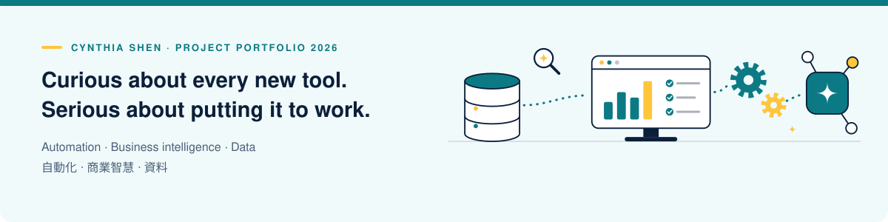
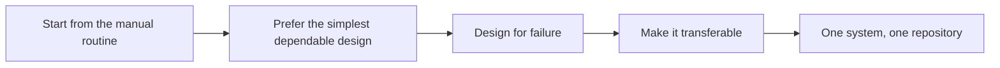
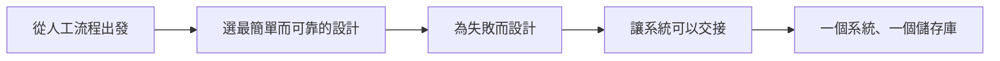

  

  <b>English</b> · <a href="#中文">中文</a>

  
  
  
  
  
  
  
  
  
  

# Cynthia Shen — Project Portfolio

Automation, business intelligence and data projects I designed and built on my own. Most were made for, and are operated at, the Taiwan subsidiary of a multinational industrial manufacturer; projects done elsewhere are listed separately.

> **About this repository.** These are case studies, not source code. The systems belong to my employer, so company, partner, system and people names are replaced with generic descriptions, and no internal data, addresses or credentials appear here. I am happy to walk through design decisions in detail in conversation.

  <a href="#projects">Projects</a> ·
  <a href="#skills-these-projects-demonstrate">Skills</a> ·
  <a href="#how-i-work">How I work</a>

## At a glance

| 11 | 2 | 3 | 5 | 1 |
|:---:|:---:|:---:|:---:|:---:|
| case studies | workflow automation systems | Power BI dashboards | Python and RPA tools | project done elsewhere |

## Projects

### ⚙️ Workflow automation

| # | Project | What it does | Main technologies |
|---|---|---|---|
| 1 | [Digital request intake and triage](projects/01-request-intake-automation.md) | Turns ad-hoc requests into a scored, approved and tracked pipeline | Power Automate, Microsoft Forms, SharePoint Lists, Approvals, Teams |
| 4 | [Daily shipment report distribution](projects/04-daily-report-distribution.md) | Replaces a manual daily export-and-email routine | Power Automate, DAX queries, Office Scripts, SharePoint |

### 📊 Business intelligence

| # | Project | What it does | Main technologies |
|---|---|---|---|
| 2 | [Monthly sales and order dashboard](projects/02-sales-order-dashboard.md) | One report for net sales, order intake and open order book, kept under version control | Power BI (PBIP, TMDL), DAX, Snowflake, Git |
| 3 | [Air-freight cost analysis dashboard](projects/03-air-freight-dashboard.md) | Estimates air-freight charges and shows them against sales, down to the invoice line | Power BI (PBIP), DAX, Power Query, Snowflake |
| 8 | [Workshop profitability dashboard](projects/08-workshop-profitability-dashboard.md) | Turns a monthly finance workbook into a profit view by site, refreshed by saving one file | Power BI (PBIP, TMDL), Power Query M, DAX |

### 🐍 Python and RPA

| # | Project | What it does | Main technologies |
|---|---|---|---|
| 5 | [Configurable web-portal report downloader](projects/05-portal-report-downloader.md) | Signs in to a third-party portal and delivers its reports to a team library on a schedule | Python, Playwright, Windows Task Scheduler, PowerShell |
| 6 | [Cross-tenant file change watcher](projects/06-file-change-watcher.md) | Detects changes to a partner-hosted spreadsheet and keeps timestamped versions | Python, Playwright, HTTP ETag, SHA-256, Power Automate |
| 7 | [Small utilities](projects/07-small-utilities.md) | Folder inventory to Excel; automatic consolidation of Excel files; database access through a standard protocol | Python, pandas, openpyxl, PostgreSQL |
| 9 | [Invoice payment-request assistant](projects/09-invoice-payment-request-assistant.md) | Reads supplier invoices with OCR and fills in the payment-request form for review | Python, Flask, Tesseract OCR, Outlook automation |
| 10 | [Customer-service order-to-invoice workflow](projects/10-customer-service-order-workflow.md) 🚧 *in progress* | A tested rules engine and platform design for a customer's procurement-portal process | Python, pytest, Snowflake SQL, Dataverse, Power Automate |

### 🧩 Other projects

Projects done elsewhere.

| # | Project | What it does | Main technologies |
|---|---|---|---|
| 11 | [Carton label generator](projects/11-carton-label-generator.md) | Turns a catering kitchen's daily order sheets into print-ready carton labels and accounting data | Python, python-docx, openpyxl, RapidOCR |

## Skills these projects demonstrate

| Area | Evidence |
|---|---|
| ⚙️ Low-code automation | Six cooperating cloud flows with a 12-state lifecycle, approvals, reminders and time-outs (project 1); scheduled reporting with success and failure branches (project 4) |
| 📊 Business intelligence | Semantic models on a cloud data warehouse, DAX measures, drill-through pages, an in-report user guide (projects 2 and 3); a folder-driven monthly refresh checked against finance figures (project 8) |
| 🐍 Scripting and RPA | Browser automation that separates a reusable engine from per-site configuration; retry, validation and failure evidence (projects 5 and 6); OCR with a mandatory human check (projects 9 and 11); a rules engine with 66 automated tests (project 10) |
| 🔐 Security practice | Credentials held in the operating system's credential store, never in files; secrets stripped from deployment packages and kept out of version control, with example templates in their place |
| 🚀 Release discipline | Separate development and production environments, each system deployed on its own, semantic versioning, changelogs and rollback notes |
| 📝 Documentation | Each system has a README, a runbook and decision records explaining why a design was chosen; the larger ones also have requirements and as-built documents |

## How I work

1. **Start from the manual routine.** I write down what people do today, how long it takes and where it goes wrong, before choosing a tool.
2. **Prefer the simplest dependable design.** A scheduled flow beats a robot; an API or a mail subscription beats screen automation. I record the better long-term option even when I cannot build it yet.
3. **Design for failure.** Each automation says what happens when it fails, who is told, and what evidence is kept.
4. **Make it transferable.** Installers, runbooks and decision records mean a system does not depend on my memory or my computer.
5. **One system, one repository.** Changes go through a branch and a checklist; production is reached by a tagged release.

---

  <a href="#cynthia-shen--project-portfolio">English</a> · <b>中文</b>

# Cynthia Shen — 專案作品集

我獨立設計並建置的自動化、商業智慧與資料專案。大部分是為一家跨國工業製造商的台灣分公司製作並在當地維運；其他來源的專案另外列出。

> **關於本儲存庫。** 這裡放的是案例說明，不是原始碼。系統屬於任職公司，因此公司、合作夥伴、系統與人員名稱都以一般性描述代替，也不含任何內部資料、網址或帳密。設計上的取捨歡迎在面談時詳細說明。

## 一眼看懂

| 11 | 2 | 3 | 5 | 1 |
|:---:|:---:|:---:|:---:|:---:|
| 個案例 | 套流程自動化系統 | 份 Power BI 報表 | 個 Python 與 RPA 工具 | 個其他來源的專案 |

## 專案

### ⚙️ 流程自動化

| # | 專案 | 做什麼 | 主要技術 |
|---|---|---|---|
| 1 | [數位需求受理與分流](projects/01-request-intake-automation.md#中文) | 把零散的需求變成有評分、有核准、可追蹤的流程 | Power Automate、Microsoft Forms、SharePoint 清單、Approvals、Teams |
| 4 | [每日出貨報表自動寄送](projects/04-daily-report-distribution.md#中文) | 取代每天人工匯出並寄信的例行作業 | Power Automate、DAX 查詢、Office Scripts、SharePoint |

### 📊 商業智慧

| # | 專案 | 做什麼 | 主要技術 |
|---|---|---|---|
| 2 | [月度銷售與訂單戰情報表](projects/02-sales-order-dashboard.md#中文) | 一份報表看淨銷售、接單與未交訂單，並納入版本控管 | Power BI（PBIP、TMDL）、DAX、Snowflake、Git |
| 3 | [空運運費分析報表](projects/03-air-freight-dashboard.md#中文) | 估算空運費用並對照銷售額，可下鑽到發票明細 | Power BI（PBIP）、DAX、Power Query、Snowflake |
| 8 | [工場獲利分析報表](projects/08-workshop-profitability-dashboard.md#中文) | 把每月財務活頁簿變成各據點的獲利畫面，存一個檔就完成更新 | Power BI（PBIP、TMDL）、Power Query M、DAX |

### 🐍 Python 與 RPA

| # | 專案 | 做什麼 | 主要技術 |
|---|---|---|---|
| 5 | [可設定的入口網站報表下載器](projects/05-portal-report-downloader.md#中文) | 定時登入第三方入口網站，把報表送進團隊文件庫 | Python、Playwright、Windows 工作排程器、PowerShell |
| 6 | [跨租用戶檔案變更監看](projects/06-file-change-watcher.md#中文) | 偵測合作夥伴端試算表的變更並保留帶時間戳的版本 | Python、Playwright、HTTP ETag、SHA-256、Power Automate |
| 7 | [小工具](projects/07-small-utilities.md#中文) | 資料夾清冊輸出 Excel；Excel 檔自動合併；以標準協定存取資料庫 | Python、pandas、openpyxl、PostgreSQL |
| 9 | [發票請款輔助工具](projects/09-invoice-payment-request-assistant.md#中文) | 以 OCR 讀取供應商發票並填好請款單，供人檢查 | Python、Flask、Tesseract OCR、Outlook 自動化 |
| 10 | [客服訂單到發票作業流程](projects/10-customer-service-order-workflow.md#中文) 🚧 進行中 | 針對客戶採購入口網站作業的規則引擎（已通過測試）與平台設計 | Python、pytest、Snowflake SQL、Dataverse、Power Automate |

### 🧩 其他專案

其他來源的專案。

| # | 專案 | 做什麼 | 主要技術 |
|---|---|---|---|
| 11 | [紙箱標籤產生器](projects/11-carton-label-generator.md#中文) | 把團膳廚房每天的訂單變成可列印的紙箱標籤與會計資料 | Python、python-docx、openpyxl、RapidOCR |

## 這些專案展現的能力

| 面向 | 佐證 |
|---|---|
| ⚙️ 低程式碼自動化 | 六支互相配合的雲端流程，含 12 個狀態的生命週期、核准、提醒與逾時（專案 1）；含成功與失敗分支的排程報表（專案 4） |
| 📊 商業智慧 | 建立在雲端資料倉儲上的語意模型、DAX 量值、鑽研頁、內建於報表的使用指南（專案 2、3）；以資料夾驅動的每月更新，並與財務數字核對（專案 8） |
| 🐍 指令碼與 RPA | 把可重用引擎與各網站設定分開的瀏覽器自動化；重試、驗證與失敗現場保存（專案 5、6）；必經人工確認的 OCR（專案 9、11）；有 66 個自動化測試的規則引擎（專案 10） |
| 🔐 資安實務 | 帳密放在作業系統的認證存放區，不寫入檔案；部署包自動去除機密，機密不進版本控管，改以範本檔代替 |
| 🚀 發行紀律 | 開發與正式環境分離、每個系統各自部署、語意化版本、變更紀錄與回復說明 |
| 📝 文件 | 每個系統都有 README、操作手冊與說明設計理由的決策紀錄；較大的系統另有需求文件與竣工文件 |

## 我的工作方式

1. **從人工流程出發。** 先寫下現在怎麼做、花多久、哪裡會出錯，再選工具。
2. **選最簡單而可靠的設計。** 排程流程優於機器人；API 或郵件訂閱優於畫面自動化。即使當下做不到，也會記下更好的長期方案。
3. **為失敗而設計。** 每個自動化都交代失敗時會發生什麼、通知誰、留下什麼證據。
4. **讓系統可以交接。** 有安裝程式、操作手冊與決策紀錄，系統不依賴我的記憶或我的電腦。
5. **一個系統、一個儲存庫。** 修改走分支與檢查清單；打上版號的發行才進正式環境。
