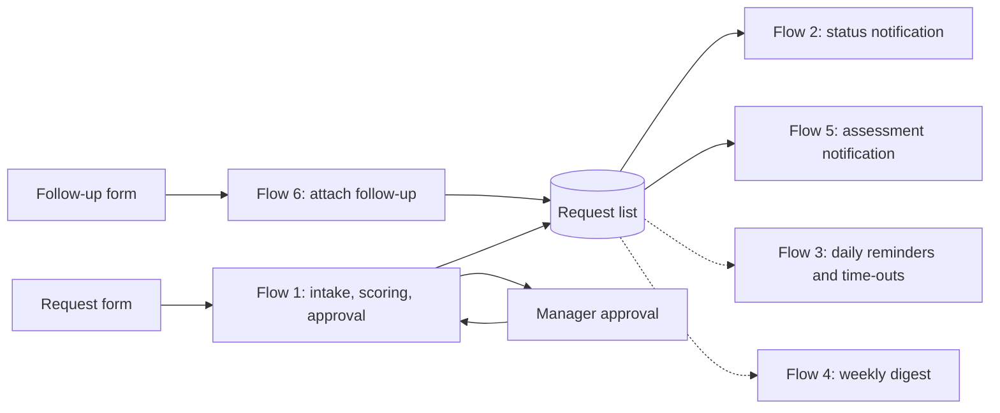

# 1. Digital request intake and triage

*[中文](#中文)*

## Problem
Requests for reports, automations and data work needed one entry point, the same information for every request so they could be compared, and a status the requester could follow.

## What I built
A request pipeline on Microsoft 365 with no custom server:

- **Two forms**: a branching request form (the questions change with the request type) and a follow-up form for supplying missing information.
- **One SharePoint list** as the system of record, with views sorted by priority.
- **Six cloud flows**, each with one job. They do not call each other; they coordinate through the list's status and flag columns.

| Flow | Trigger | Job |
|---|---|---|
| 1 Intake | New form response | Looks up requester and manager, issues a request number, scores value and feasibility, suggests a tool, sends for approval, books a meeting after approval when one is requested |
| 2 Status notification | Status changed | Tells the requester the new status and why |
| 3 Reminders | Weekdays, morning | Chases approvals, assessments and missing information; closes requests that time out |
| 4 Weekly digest | Mondays | New requests and the five highest priorities |
| 5 Assessment notification | Flag ticked on the list | Sends the assessment or the manager's comment |
| 6 Follow-up | New follow-up response | Checks the request number and sender, attaches the content, moves the request back to triage |

## Design points
- **Scoring is rule-based and explainable.** Automation requests get a 0–100 feasibility score from five factors: trigger clarity, system connectivity, repetition volume, exception complexity and completeness of examples. The scoring table is in the documentation so anyone can verify a result by hand.
- **A 12-state lifecycle** separates a human decision ("rejected") from a system time-out ("closed").
- **Time-outs are explicit**: reminders from day 3, automatic closure at day 14, review of postponed requests after 30 days.
- **A requester who is a manager skips approval**, detected from the directory rather than from a maintained list.
- **Built in a development environment and promoted to production**, with an environment comparison table, a cut-over checklist and a rollback procedure.

## Result
- A requester receives a request number, a feasibility level and a suggested tool within about three minutes of submitting.
- Seven of eight test scenarios were exercised and passed before go-live; the eighth (the 14-day time-out paths) is in place and awaits a real case.
- Known limitations are written down, for example that time-outs count calendar days, not working days.

## Technologies
Power Automate, Microsoft Forms, SharePoint Lists, Approvals, Outlook, Teams, Office 365 Users connector, separate Power Platform development and production environments.

---

# 1. 數位需求受理與分流

## 問題
報表、自動化與資料處理的需求，需要單一入口、每件需求都有相同的資訊以便比較，以及申請人看得到的進度。

## 我做了什麼
在 Microsoft 365 上建立的需求處理流程，不需自建伺服器：

- **兩張表單**：會依需求類型分支的申請表，以及補件用的表單。
- **一份 SharePoint 清單**作為唯一紀錄，並有依優先度排序的檢視。
- **六支雲端流程**，各司一職。流程之間不互相呼叫，而是透過清單的狀態與旗標欄位協調。

| 流程 | 觸發 | 工作 |
|---|---|---|
| 1 受理 | 表單收到新回覆 | 查出申請人與主管、產生編號、計算價值與可行性分數、建議工具、送主管核准、核准後依需求自動排會 |
| 2 狀態通知 | 狀態變更 | 通知申請人新狀態與原因 |
| 3 逾時提醒 | 工作日早上 | 催核准、催評估、催補件；逾時自動關閉 |
| 4 每週摘要 | 每週一 | 新需求與優先度前五名 |
| 5 評估通知 | 清單上勾選旗標 | 寄出評估結果或主管意見 |
| 6 補件處理 | 補件表收到新回覆 | 比對編號與身分、附加內容、把需求送回分流 |

## 設計重點
- **評分以規則為本、可以解釋。** 自動化類需求依五個因子得出 0–100 的可行性分數：觸發明確度、系統連接性、重複量、例外複雜度、範例完整度。評分表寫在文件裡，任何人都能手算驗證。
- **12 個狀態的生命週期**，把人為決定（已拒絕）與系統逾時（已關閉）分開。
- **逾時規則明確**：第 3 天起提醒、第 14 天自動關閉、延後的需求 30 天後回顧。
- **申請人本身是主管時免簽核**，由目錄判斷，不靠人工維護名單。
- **在開發環境建置、再發布到正式環境**，附環境對照表、切換檢查清單與回復程序。

## 成果
- 申請人送出後約三分鐘內收到編號、可行性等級與建議工具。
- 上線前八個測試情境中七個已實測通過；第八個（14 天逾時路徑）邏輯已就位，待實際案件驗證。
- 已知限制都有記錄，例如逾時以日曆天而非工作天計算。

## 技術
Power Automate、Microsoft Forms、SharePoint 清單、Approvals、Outlook、Teams、Office 365 Users 連接器、分離的 Power Platform 開發與正式環境。
