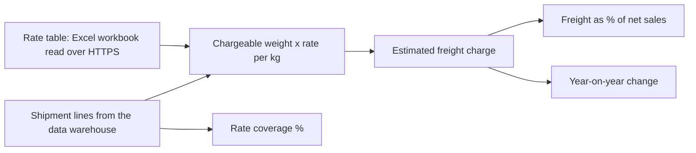

# 3. Air-freight cost analysis dashboard

*[中文](#中文)*

## Problem
Air freight is the expensive exception in logistics. To discuss it with facts, the team needed an estimate of air-freight charges per shipment, a view of how large those charges are relative to sales, and a way to see which shipments could not be rated at all.

## What I built
A Power BI report that estimates freight charges from shipped weight and a rate table, then presents them at three levels:

| Page | Content |
|---|---|
| Overview | Six KPI cards, a combined column-and-line trend, a bar chart and a matrix, with seven slicers |
| Analysis | Comparison charts and trends for exploring what drives the charges |
| Detail | A line-level table for checking individual shipments |
| Drill-through: shipping unit and invoice date | One shipping unit on one date |
| Drill-through: shipping unit, invoice date and invoice line | The same, down to the invoice line |

The model has two shipment tables at different grains (by shipping unit and date, and by invoice line), both from the cloud data warehouse, related to a rate table that holds a rate per kilogram for each shipping unit.

## Design points
- **Rates are data, not constants.** The rate workbook's location and sheet name are query parameters, and a packing factor is a parameter too, so a rate change or a move of the file needs no change to the report logic.
- **The report measures its own blind spots.** A *rate coverage* measure shows the share of shipments that could be rated, and turns red below 98%. Lines with no recorded weight, and lines where net weight had to stand in for gross weight, are counted instead of being silently dropped.
- **Ratios are computed on a like-for-like base.** Freight as a percentage of net sales divides by the sales of rated shipments only, so unrated shipments do not flatter the figure.
- **Twelve DAX measures** cover charge, weight, sales, coverage, prior-year comparison and conditional colours.
- **Stored as a Power BI project (PBIP)** under version control, with a changelog and a runbook describing how to change and publish it.

## Technologies
Power BI Desktop, PBIP / TMDL, DAX, Power Query (M) with parameters, Snowflake, Excel, Git.

---

# 3. 空運運費分析報表

## 問題
空運是物流中昂貴的例外。要用事實討論它，團隊需要每筆出貨的空運費用估算、這些費用相對於銷售額的比重，以及看出哪些出貨根本無法計價。

## 我做了什麼
一份 Power BI 報表，以出貨重量與費率表估算運費，並分三個層次呈現：

| 頁面 | 內容 |
|---|---|
| 總覽 | 六張 KPI 卡、直條與折線組合趨勢圖、橫條圖與矩陣，搭配七個交叉分析篩選器 |
| 分析 | 用來探索費用成因的比較圖與趨勢 |
| 明細 | 逐筆核對出貨用的明細表 |
| 鑽研：出貨單位與發票日期 | 單一出貨單位在某一天 |
| 鑽研：出貨單位、發票日期與發票明細 | 同上，下到發票明細行 |

模型有兩張不同粒度的出貨資料表（依出貨單位與日期，以及依發票明細行），都來自雲端資料倉儲，並關聯到一張記錄各出貨單位每公斤費率的費率表。

## 設計重點
- **費率是資料，不是常數。** 費率活頁簿的位置與工作表名稱是查詢參數，包裝加成也是參數，因此費率調整或檔案搬移都不必更動報表邏輯。
- **報表會量測自己的盲點。** 「費率涵蓋率」量值顯示可計價出貨的比例，低於 98% 時轉為紅色。沒有重量紀錄的明細，以及以淨重代替毛重的明細，都會被計數，而不是默默略過。
- **比率以相同基礎計算。** 運費占淨銷售的百分比，分母只取可計價出貨的銷售額，未計價的出貨不會讓數字變好看。
- **十二個 DAX 量值**，涵蓋運費、重量、銷售額、涵蓋率、去年同期比較與條件式色彩。
- **以 Power BI 專案檔 (PBIP) 儲存**並納入版本控管，附變更紀錄與說明如何修改、發佈的操作手冊。

## 技術
Power BI Desktop、PBIP／TMDL、DAX、含參數的 Power Query (M)、Snowflake、Excel、Git。
