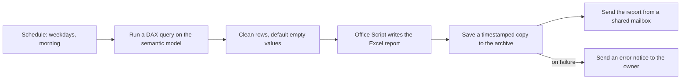

# 4. Daily shipment report distribution

*[中文](#中文)*

## Problem
Every working day someone on the logistics team signed in to Power BI, exported shipment and order data, tidied it into an Excel file and e-mailed it to several groups. The routine was sometimes late or forgotten, copy-and-paste introduced errors, only the latest file was kept, and nobody was told when it failed.

## What I built
A scheduled cloud flow that does the whole routine:

## Design points
- **The report is fed from the same semantic model people already trust**, queried with DAX, so the file and the dashboard cannot disagree.
- **Empty values are handled in one place** before writing, so a missing field cannot shift columns.
- **An Office Script writes the rows in bulk**, in one call instead of one connector action per row.
- **Every run is archived** with a timestamp, so a past day's report can be retrieved.
- **Failure has its own branch.** The owner is told at once instead of hearing from a recipient days later.
- **Delivered as a solution** with a requirements document and a technical manual, ready to move between environments.

## Result
- Estimated saving of 20 to 30 minutes of manual work each working day.
- A consistent recipient list and an auditable history of what was sent.

## Technologies
Power Automate, Power BI semantic model queries (DAX), Office Scripts, Excel Online, SharePoint, Outlook shared mailbox.

---

# 4. 每日出貨報表自動寄送

## 問題
每個工作日，物流團隊都有人登入 Power BI、匯出出貨與訂單資料、整理成 Excel，再寄給數個群組。這項例行作業有時延遲或忘記，複製貼上會出錯，只保留最新一份檔案，失敗時也沒有人被通知。

## 我做了什麼
一支排程的雲端流程，完成整個例行作業：工作日早上觸發 → 對語意模型執行 DAX 查詢 → 整理資料列並補上空值預設 → 以 Office Script 寫入 Excel 報表 → 另存帶時間戳的副本到歸檔資料夾 → 由共用信箱寄出；歸檔失敗時則另寄錯誤通知給負責人。

## 設計重點
- **報表資料來自大家已經信任的同一個語意模型**，以 DAX 查詢，因此檔案與戰情報表不會不一致。
- **空值在寫入前統一處理**，欄位缺值不會造成錯位。
- **以 Office Script 批次寫入**，一次呼叫完成，而不是每列一個連接器動作。
- **每次執行都歸檔**並帶時間戳，可取回過去任一天的報表。
- **失敗有自己的分支。** 負責人立刻收到通知，而不是幾天後才從收件人那裡聽說。
- **以方案 (Solution) 交付**，附需求文件與技術手冊，可在環境之間移轉。

## 成果
- 估計每個工作日節省 20 至 30 分鐘人工作業。
- 收件名單一致，寄出的內容有可稽核的歷史。

## 技術
Power Automate、Power BI 語意模型查詢 (DAX)、Office Scripts、Excel Online、SharePoint、Outlook 共用信箱。
