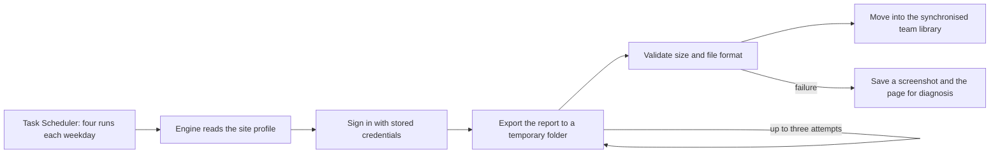

# 5. Configurable web-portal report downloader

*[中文](#中文)*

## Problem
A service partner publishes a report only inside its web portal: no API, no scheduled e-mail, no file feed. Someone had to sign in several times a day, export the report and upload it to the team's document library. An earlier script for this failed because it assumed the wrong sign-in fields.

## What I built
A browser-automation tool in two parts:

| Part | Role |
|---|---|
| Engine | One Python program shared by every site: sign in, open each report, export, validate, save |
| Site profile | One JSON file per site: sign-in fields, report addresses, button selectors, destination folder |

Adding a report, or a whole new website, means writing a profile. The engine is not edited.

## Design points
- **Credentials live in the Windows credential store.** I call the operating system's API directly from the standard library, because a third-party package installed for one user was invisible to the scheduled task. Nothing sensitive is written to a file or an environment variable.
- **Download first, move second.** The file lands in a temporary folder and is moved only when complete, so the sync client never uploads half a file.
- **The destination is discovered, not assumed.** The same library is mounted at different local paths on different computers; the engine tries a configured path, then known alternatives, then a search pattern, and stops with a clear message instead of writing somewhere wrong.
- **Failures leave evidence.** A screenshot and the page source are saved, so a changed button label can be fixed from the profile without debugging.
- **It can be moved to another computer in three steps**: disconnect the old one, run the installer on the new one, done. The installer sets up Python, the browser, credentials and the schedule. A separate script removes everything cleanly.
- **I documented the better long-term options**: ask the partner for a scheduled e-mail or a data interface, or call the export address directly without a browser.

## Result
- The team library is refreshed with the current report four times each weekday with no manual step.
- Applying the tool to another website is a documented four-step procedure that needs no code change.

## Technologies
Python, Playwright, Windows Credential Manager (ctypes), Windows Task Scheduler, PowerShell, batch installers.

---

# 5. 可設定的入口網站報表下載器

## 問題
一家服務合作夥伴只在自己的入口網站內提供報表：沒有 API、沒有定時郵件、沒有檔案介接。必須有人每天登入數次、匯出報表，再上傳到團隊文件庫。先前的指令碼因為假設了錯誤的登入欄位而失敗。

## 我做了什麼
分成兩部分的瀏覽器自動化工具：

| 部分 | 角色 |
|---|---|
| 引擎 | 所有網站共用的一支 Python 程式：登入、開啟各報表、匯出、驗證、存檔 |
| 站點參數檔 | 每個網站一個 JSON：登入欄位、報表位址、按鈕選擇器、存放資料夾 |

新增一份報表，或套用到全新的網站，只需要寫參數檔，不必修改引擎。

## 設計重點
- **帳密存在 Windows 認證管理員。** 我用標準函式庫直接呼叫作業系統 API，因為裝在使用者層的第三方套件，排程工作讀不到。任何機密都不寫入檔案或環境變數。
- **先下載、再搬移。** 檔案先落在暫存資料夾，完整後才搬入，同步用戶端不會上傳半個檔案。
- **存放位置用找的，不用猜的。** 同一個文件庫在不同電腦上的本機路徑不同；引擎依序嘗試設定的路徑、已知的替代路徑、搜尋樣式，找不到就清楚報錯，不會寫到錯的地方。
- **失敗會留下現場。** 保存截圖與頁面原始碼，按鈕文字改了只要照著修改參數檔，不必除錯。
- **三個步驟就能移到另一台電腦**：舊機斷開、新機執行安裝程式、完成。安裝程式會備妥 Python、瀏覽器、帳密與排程；另有指令碼可乾淨移除。
- **記下了更好的長期方案**：請合作夥伴提供定時郵件或資料介接，或直接呼叫匯出位址而不開瀏覽器。

## 成果
- 團隊文件庫每個工作日四次自動更新為最新報表，沒有人工步驟。
- 套用到另一個網站是有文件的四個步驟，不需修改程式。

## 技術
Python、Playwright、Windows 認證管理員 (ctypes)、Windows 工作排程器、PowerShell、批次安裝程式。
