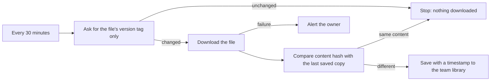

# 6. Cross-tenant file change watcher

*[中文](#中文)*

## Problem
A logistics partner maintains a daily inventory spreadsheet in its own cloud storage, in a different Microsoft 365 tenant, and overwrites it in place. The team wanted each version kept with the time it changed, instead of only ever seeing the latest one.

## What I built
A scheduled watcher that checks the partner's file and saves a timestamped copy to the team library only when the content has really changed.

## Design points
- **Check cheaply, download rarely.** Remote cloud storage offers no change event to subscribe to, so polling is unavoidable. A header-only request reads the version tag in a few hundred bytes; the file itself is fetched only when the tag changes.
- **Two tests for "changed".** A new version tag triggers the download; a SHA-256 comparison then confirms the content differs. A re-save without edits does not create a duplicate.
- **Two ways to reach the file.** If the sharing link stops working because the partner re-uploaded the file, the watcher falls back to the folder path and fixed file name.
- **Alerts degrade gracefully**: a cloud-flow webhook first, then the local mail client, then a marker file in the destination folder. The first that succeeds ends the chain, and a cooldown prevents a flood of repeats.
- **The deployment package strips the secret.** The script that builds an installable package removes the webhook address, so a secret never lands in a synchronised folder.
- **One computer at a time.** Two computers running the schedule would write conflicting copies, so the uninstall script comes first in the migration steps.

## Result
- Every changed version of the inventory sheet is kept with the time it was captured.
- An expired sign-in session is reported clearly, with the one command needed to renew it.

## Technologies
Python, Playwright (persistent browser profile for interactive sign-in), HTTP conditional requests (ETag), SHA-256, Power Automate HTTP trigger, Windows Task Scheduler, PowerShell.

---

# 6. 跨租用戶檔案變更監看

## 問題
一家物流合作夥伴在自己的雲端儲存空間（另一個 Microsoft 365 租用戶）維護每日庫存表，並直接覆寫同一個檔案。團隊希望保留每個版本與變動時間，而不是永遠只看得到最新的一份。

## 我做了什麼
一支排程的監看程式，檢查合作夥伴的檔案，只有在內容真的變了才存一份帶時間戳的副本到團隊文件庫。

## 設計重點
- **便宜地檢查、少量地下載。** 遠端雲端儲存沒有可訂閱的變更事件，只能輪詢。只要求標頭的請求，用幾百位元組就能讀到版本標記；標記變了才下載檔案本身。
- **「有變更」要通過兩道檢查。** 版本標記變了才下載；再以 SHA-256 比對確認內容不同。沒有修改的重新儲存不會產生重複檔。
- **兩條取檔路徑。** 合作夥伴重新上傳導致分享連結失效時，改用資料夾路徑加固定檔名。
- **告警逐層備援**：先用雲端流程的 Webhook，再用本機郵件用戶端，最後在存放資料夾丟一個標記檔。成功一層就停，並有冷卻時間避免重複轟炸。
- **部署包會去除機密。** 產生安裝包的指令碼會移除 Webhook 位址，機密不會落入同步資料夾。
- **同一時間只在一台電腦執行。** 兩台同時跑會寫出衝突複本，所以移機步驟的第一步是在舊機執行移除指令碼。

## 成果
- 庫存表每個有變更的版本都被保留，並帶有擷取時間。
- 登入工作階段過期時會清楚回報，並附上更新所需的那一行指令。

## 技術
Python、Playwright（以持久化瀏覽器設定檔處理互動式登入）、HTTP 條件式請求 (ETag)、SHA-256、Power Automate HTTP 觸發程序、Windows 工作排程器、PowerShell。
