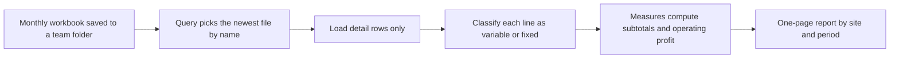

# 8. Workshop profitability dashboard

*[中文](#中文)*

## Problem
Finance publishes a monthly profit-and-loss workbook for a workshop business that runs at two sites. Management wanted one view of sales, variable cost, fixed cost and operating profit for each site and for the total, without anyone re-keying numbers each month. The workbook was built for people to read, not for a program: subtotal rows mixed with detail rows, one sheet per site and year, and a column header that carried the wrong year.

## What I built
A Power BI project (PBIP format, stored as text files under version control) with a small star schema: one fact table of profit-and-loss lines and dimensions for workshop, category, cost structure and reporting line.

## Design points
- **The monthly update needs no settings change.** Whoever saves the new workbook into the folder has finished the job; the query takes the file whose name sorts last, so a later month or a higher revision wins.
- **The year comes from the sheet name, not the column header**, because one year's sheet carried the next year's header.
- **Subtotals are calculated, not imported.** Only detail rows and a few named lines are loaded; operating profit is the sum. This avoids double counting when the source layout changes.
- **The total is its own data set.** With no site selected the report shows the published total rather than adding sites together, so it always matches the finance figure.
- **Site address, folder path and the rework account are parameters**, so nothing is fixed in the query text.
- **Blank period means latest.** If no period is chosen, the report shows the most recent month that has numbers.

## Result
- Version 1.0.0 released. Its year-to-date figures for sales, cost ratios and operating profit were checked against the finance presentation for the same period, for the total and for each site.
- The monthly routine is: save the file, press refresh.

## Technologies
Power BI Desktop (PBIP, TMDL), Power Query M, DAX, SharePoint folder source, Git.

---

# 8. 工場獲利分析報表

## 問題
財務每月提供一份工場業務的損益活頁簿，業務分在兩個據點。管理層想用同一個畫面看各據點與合計的銷售、變動成本、固定成本與營業利益，而且不要每個月人工重打數字。這份活頁簿是給人看的，不是給程式讀的：小計列與明細列混在一起、每個據點每個年度各一張工作表，還有一張表的欄標題寫錯年份。

## 我做了什麼
一個 Power BI 專案（PBIP 格式，以文字檔納入版本控管），採小型星狀結構：一張損益明細事實表，加上工場、類別、成本結構與報表列四個維度。

## 設計重點
- **每月更新不需要改任何設定。** 把新檔存進資料夾就完成了；查詢取檔名排序最後的一份，所以月份較新或版號較大的會被採用。
- **年度取自工作表名稱，不看欄標題**，因為有一年的工作表寫的是下一年的標題。
- **小計用算的，不用匯入的。** 只載入明細列與少數指定列，營業利益由加總得出，來源版面變動時不會重複計算。
- **合計是獨立的一組資料。** 沒有選據點時顯示財務公布的合計，而不是把各據點相加，因此一定對得上財務數字。
- **網站位址、資料夾路徑與重工科目都是參數**，查詢文字裡沒有寫死的值。
- **期間不選就是最新。** 沒有選期間時，自動顯示最近一個有數字的月份。

## 成果
- 已發行 1.0.0 版。年初至今的銷售、成本比率與營業利益，已與同期財務簡報逐項核對（合計與各據點）。
- 每月作業變成：存檔、按重新整理。

## 技術
Power BI Desktop（PBIP、TMDL）、Power Query M、DAX、SharePoint 資料夾來源、Git。
