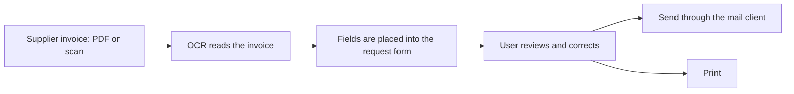

# 9. Invoice payment-request assistant

*[中文](#中文)*

## Problem
Paying a supplier invoice meant reading the invoice, typing its details into a payment-request form, printing or e-mailing the form, and filing the result. The work was repetitive and typing errors were easy to make.

## What I built
A desktop tool with a browser-based screen that runs entirely on the user's computer. It reads a supplier invoice with optical character recognition (OCR), fills in the payment-request form, and lets the user check the result before sending it by e-mail or printing it.

## Design points
- **Nothing to install.** The Python runtime, the OCR engine and the PDF tools travel inside the application folder, so a colleague starts it with one batch file.
- **A person confirms before anything leaves.** OCR output is a proposal; the user reviews the form before it is sent or printed.
- **Program and data are separate.** Real invoices, generated forms and the local settings file stay out of version control; an example settings file documents what is needed.
- **Two lines of development are kept apart.** The stand-alone version in daily use is on the main branch; a later variant with a database, sign-in and synchronisation is kept on its own branch and is not the version in use.
- **History was rebuilt honestly.** The tool existed as dated folder copies before it had version control. I rebuilt those copies into a commit history and recorded how and why in a decision record.
- **Documentation is generated from source.** The requirements document, user manual and walkthrough script are kept as Markdown, with helper scripts that produce the Word, slide and annotated-screenshot versions.

## Result
- Version 1.0.0 of the stand-alone edition is released and is the edition in use.
- Requirements, user manual and runbook are in the repository alongside the code.

## Technologies
Python (embedded runtime), Flask (local web interface), openpyxl, Tesseract OCR, Poppler, Outlook automation, batch launchers.

---

# 9. 發票請款輔助工具

## 問題
付款給供應商時，要先看發票、把內容打進請款單、列印或寄出請款單，再把結果歸檔。這些動作重複性高，也容易打錯。

## 我做了什麼
一個在使用者電腦上執行、以瀏覽器作為畫面的桌面工具。它用光學字元辨識（OCR）讀取供應商發票，自動填好請款單，讓使用者檢查後再寄出或列印。

## 設計重點
- **不需要安裝。** Python 執行環境、OCR 引擎與 PDF 工具都放在程式資料夾內，同事雙擊一個批次檔就能啟動。
- **送出前一定經過人確認。** OCR 的結果只是建議，使用者檢查請款單後才寄出或列印。
- **程式與資料分開。** 真實發票、產出的請款單與本機設定檔都不進版本控管，另以設定範本檔說明需要哪些設定。
- **兩條開發路線分開保存。** 日常使用的單機版在主分支；後來加入資料庫、登入與同步的版本放在獨立分支，不是目前使用的版本。
- **如實重建歷史。** 這個工具在納入版本控管前，是以帶日期的資料夾副本保存。我把這些副本重建成提交紀錄，並把做法與理由寫成決策紀錄。
- **文件由原稿產生。** 需求文件、操作手冊與導覽腳本以 Markdown 保存，另有輔助腳本產生 Word、簡報與標註截圖。

## 成果
- 單機版 1.0.0 已發行，是目前使用的版本。
- 需求文件、操作手冊與操作說明都和程式放在同一個儲存庫。

## 技術
Python（內嵌執行環境）、Flask（本機網頁介面）、openpyxl、Tesseract OCR、Poppler、Outlook 自動化、批次啟動檔。
