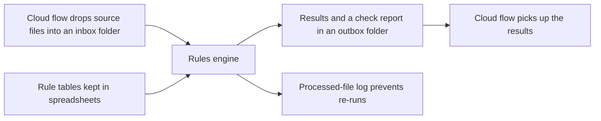

# 10. Customer-service order-to-invoice workflow (in progress)

*[中文](#中文)*

> **Status: work in progress.** Version 0.1.0 holds the process study, the design and a tested rules engine. It is not yet in production use.

## Problem
A large customer group requires its suppliers to work through its own procurement portal: order notices arrive as PDF files, deliveries must be confirmed against them, and invoices must be uploaded in a fixed spreadsheet layout that the portal rejects for many small reasons. The customer-service team handled this by hand, with knowledge spread across people and old spreadsheets. Monthly customer statements and warranty certificates were also produced manually.

## What I built so far
1. **A study of the current process**, reconstructed from meetings, a recorded walkthrough and the existing files, then reviewed with the team as an old-versus-new comparison.
2. **A rules engine in Python** covering four jobs: reading order-notice PDFs, merging arrival data and deciding shipment status, producing and checking the invoice upload file, and classifying upload rejections.
3. **Data-platform building blocks**: warehouse queries for statement lines and uniqueness checks, dataflow queries, a table specification, and a generator that builds the low-code platform solution from that specification.
4. **Document templates** for the customer statement and the warranty certificate.

## Design points
- **Rules live in spreadsheets, not in code.** Handler assignments, tax numbers, site codes and code conversions are read from reference tables, so the team can maintain them without a programmer.
- **File handoff keeps the two halves independent.** The low-code flows and the Python engine exchange files through inbox and outbox folders; a processed-file log guarantees that the same file is never handled twice.
- **Every step can be traced.** Each run writes a log and a check report, so a result can be compared with its source and reversed.
- **Duplicates are graded.** A repeated case-and-line reference is a warning; a repeated invoice-and-line reference is an error that blocks the export.
- **The engine is covered by automated tests** (66 at the time of writing), using synthetic PDF and spreadsheet fixtures in place of real customer documents.
- **The platform decision is recorded**: the reasons for choosing the target platform and what the earlier prototype is still useful for.

## Result so far
- The team has an agreed description of today's process and a proposed new one.
- The rules engine passes its test suite; the platform solution can be generated and validated from the table specification.
- Next: connect the flows, run in the development environment, then release.

## Technologies
Python (pandas, pdfplumber, reportlab, PyMuPDF, pytest), Snowflake SQL, Power Query M (dataflows), Dataverse, Power Automate.

---

# 10. 客服訂單到發票作業流程（進行中）

> **狀態：進行中。** 0.1.0 版包含流程盤點、設計與通過測試的規則引擎，尚未正式上線使用。

## 問題
一家大型客戶集團要求供應商透過它自己的採購入口網站作業：訂購通知以 PDF 送達、出貨要對著通知確認、發票要依固定的試算表格式上傳，而網站會因為許多小細節退件。客服團隊過去全靠人工，知識分散在不同人和舊試算表裡。每月的客戶對帳單與保固書也是人工製作。

## 目前做了什麼
1. **現行流程盤點**：根據會議、操作錄影與既有檔案重建流程，整理成新舊對照後與團隊確認。
2. **Python 規則引擎**，負責四件事：解析訂購通知 PDF、合併到貨資料並判定出貨狀態、產生並驗核發票上傳檔、分類上傳退件原因。
3. **資料平台的組件**：對帳明細與唯一性檢查的資料倉儲查詢、資料流查詢、資料表規格，以及依規格產生低程式碼平台方案的產生器。
4. **文件範本**：客戶對帳單與保固書。

## 設計重點
- **規則放在試算表，不寫在程式裡。** 承辦人對照、統一編號、廠區代碼與改碼規則都從對照表讀取，團隊不需要工程師就能維護。
- **以檔案交握讓兩邊各自獨立。** 低程式碼流程與 Python 引擎透過收件與送件資料夾交換檔案；已處理紀錄保證同一個檔案不會處理兩次。
- **每一步都能追蹤。** 每次執行都寫紀錄並產生驗核報告，結果可以對回來源，也可以回復。
- **重複資料分級處理。** 案號加項次重複是警示；發票加項次重複是錯誤，會擋下匯出。
- **引擎有自動化測試**（撰寫本文時為 66 個），測試用的是合成的 PDF 與試算表，不使用真實客戶文件。
- **平台決定有留下紀錄**：為什麼選定目標平台，以及先前的原型還能拿來參考什麼。

## 目前成果
- 團隊對現行流程有一致的描述，也有一份建議的新流程。
- 規則引擎通過測試；平台方案可以由資料表規格產生並驗證。
- 下一步：串接流程、在開發環境試跑、再發行。

## 技術
Python（pandas、pdfplumber、reportlab、PyMuPDF、pytest）、Snowflake SQL、Power Query M（資料流）、Dataverse、Power Automate。
