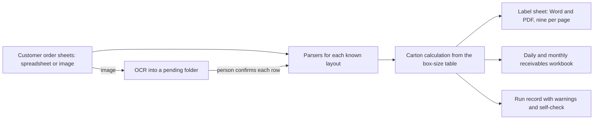

# 11. Carton label generator for a meal-catering business

*[中文](#中文)*

> This project was built for a catering business.

## Problem
A catering kitchen packs boxed meals into cartons for several corporate customers each day. Every carton needs a label showing customer, site, department, meal type and "carton i of n". Order sheets arrive in different layouts, sometimes as a photo. How many meals fit in a carton depends on the meal-box style. Labels were prepared by hand each morning, and the same numbers were typed again for accounting.

## What I built
A local tool with a four-step browser screen: add the files, confirm carton capacities, consolidate, check and print.

## Design points
- **It refuses to guess.** If any meal-box style has no carton capacity, no labels are produced and the run record lists what is missing. Wrong labels cost more than late labels.
- **It checks itself.** The meals on the labels must add up to the meals ordered; after the document is built, the page layout is re-checked to confirm nine labels per page.
- **OCR never goes straight into production.** In testing, recognition confused similar digits and dropped characters, so recognised rows wait in a pending folder, suspicious rows are highlighted with the reason, and a person releases them.
- **Updated orders are handled as updates.** A newer copy of the same file replaces the old one and the differences are recorded; two different files claiming the same customer, site and department stop the run until someone chooses.
- **It runs unattended and tolerates real offices.** A scheduled task watches for files during the morning window, waits for a file to finish copying, and saves under a new name with a warning when the output file is open in another program.
- **It moves by copying one folder.** The runtime is included, paths may contain non-English characters, and the screen reports when the schedule needs re-installing after a move.
- **Accounting gets its data from the same run**: a daily detail file and a monthly cumulative file with a price list, where cash orders are marked and kept out of receivables.

## Result
- Version 1.0.0 released, with a user manual, a specification and a recorded walkthrough.
- One run produces the print-ready labels, the accounting workbook and a record showing sources, totals and warnings.

## Technologies
Python, openpyxl, python-docx, RapidOCR, local web interface, Windows Task Scheduler, batch launchers.

---

# 11. 團膳業者的紙箱標籤產生器

> 這個專案是為一家團膳業者製作。

## 問題
團膳廚房每天要把便當裝箱，送到多家企業客戶。每個紙箱都要貼標籤，標明客戶、地點、部門、便當種類與「第 i/n 箱」。客戶的訂單格式各不相同，有時還是一張照片。一箱能裝幾個，要看便當盒的款式。過去每天早上人工製作標籤，同一批數字還要再打一次給會計。

## 我做了什麼
一個在本機執行的工具，瀏覽器畫面分四個步驟：放檔案、確認成箱數量、彙整、檢查並列印。

## 設計重點
- **不猜。** 只要有一種便當盒沒有成箱數量，就不產生標籤，並在彙整紀錄列出缺哪些。貼錯標籤的代價比晚一點出標籤高。
- **自我核對。** 標籤上的便當合計必須等於訂購總數；文件產生後還會重新檢查分頁，確認每頁九張。
- **圖片辨識的結果不會直接進正式資料。** 實測時辨識會混淆相似的數字、漏字，所以辨識結果先放在待確認資料夾，可疑的列會標示原因，由人確認後才放行。
- **客戶更新訂單時當作更新處理。** 同一份檔案的新版會取代舊版並記錄差異；兩份不同檔案宣稱同一個客戶、地點、部門時，整批暫停，等人決定留哪一份。
- **可以無人值守，也耐得住真實的辦公環境。** 排程在上午時段監看檔案，會等檔案複製完成才讀取；輸出檔正被其他程式開啟時，改存新檔名並寫入警告。
- **複製一個資料夾就能搬家。** 執行環境已內建，路徑可以有中文，搬移後畫面會提示需要重新安裝排程。
- **會計資料來自同一次執行**：當日明細與整月累計，附價目表；付現訂單會標示並排除在應收之外。

## 成果
- 已發行 1.0.0 版，附使用說明書、規格書與操作示範影片。
- 執行一次就產出可列印的標籤、會計活頁簿，以及列出來源、合計與警告的紀錄。

## 技術
Python、openpyxl、python-docx、RapidOCR、本機網頁介面、Windows 工作排程器、批次啟動檔。
